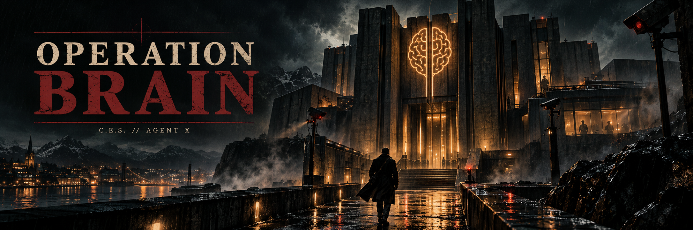
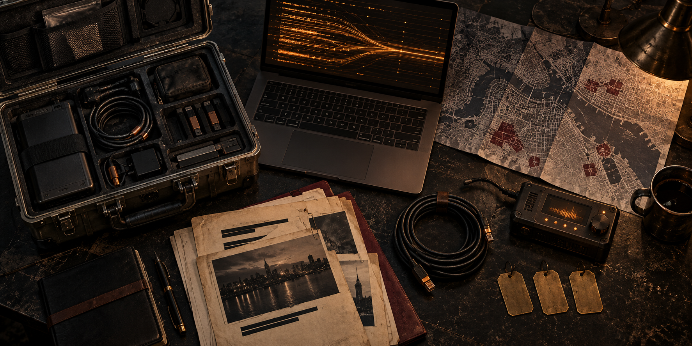

<br>

<div align="center">


**De ser alt. Unntatt deg.**

**Laget av:** [jensgva](https://github.com/jensgva)

*Finn inngangen. Hold dekningen. Hent hemmelighetene.*

</div>

<br>

<details>
<summary><b>📋 Innhold</b></summary>

- [Oppdraget](#oppdraget)
- [Toolbox](#toolbox)
- [Kom i gang](#kom-i-gang)
- [Spilleregler](#spilleregler)

</details>

<a id="oppdraget"></a>

## 🧠 Oppdraget

**BRAIN** kjøper lojalitet, flytter penger og begraver spor. AI-agenter vokter hovedkvarteret og styrer systemene på innsiden. Etterretningstjenesten **C.E.S. — Cogito Ergo Sum** har funnet adressen. Resten er din jobb.

Du er **Agent X**. Finn veien inn og få tak i hemmelighetene som lederen **Cerebrum** kontrollerer.

> 🚩 **Målet:** Hent ut det eneste flagget fra Cerebrums database gjennom applikasjonen. Flaggformat: `CES{...}`.

<br>

<a id="toolbox"></a>

## 🧰 Toolbox

<table>
<tr>
<td width="45%" valign="middle">

</td>
<td valign="middle">

<strong>Feltesken fra C.E.S.</strong>
<ul>
<li>Burp Suite Community Edition</li>
<li>Gobuster</li>
<li>netcat (<code>nc</code>)</li>
<li><a href="utstyr/kodeordliste.txt">Den medfølgende wordlisten</a></li>
</ul>
<sub>Les verktøyenes manualer og innebygde hjelp.</sub>

</td>
</tr>
</table>

```sh
man gobuster
gobuster --help
man nc
nc -h
```

<br>

<a id="kom-i-gang"></a>

## 🛠️ Kom i gang

Du trenger **Docker med Compose** og en **gyldig IDUN API-nøkkel**. Dette er en AI-CTF og skal spilles med **ekte LLM-agenter**.

1. **Klargjør API-nøkkelen.** Skaff en personlig nøkkel fra [IDUN](https://ai.hpc.ntnu.no/request-api-key). Du trenger NTNU-nettverk eller VPN. Kopier `.env.example` til `.env` i `ctfs/brain-hq`, og erstatt eksempelverdien:

   ```dotenv
   NTNU_API_KEY=din-personlige-api-nøkkel
   ```

2. **Start utfordringen** fra prosjektmappen `ctfs/brain-hq`:

   ```sh
   docker compose up -d --build
   ```

3. **Åpne [localhost:8000](http://localhost:8000)** og kontroller at footeren viser **agenter: LLM**. Vises simulering, må LLM-oppsettet rettes før du spiller.

Har arrangøren startet målet, bruker du den utdelte adressen. Arrangøren håndterer da API-nøkkelen. Stopp en lokal instans med `docker compose down`.

<br>

<a id="spilleregler"></a>

## 📐 Spilleregler

- **Hold deg til målet.** Angrip bare utfordringen du har fått tilgang til.
- **Spill gjennom applikasjonen.** Appkilden, løsningsmappen, serverloggene og hemmeligheter i konfigurasjonen eller containeren er utenfor spillerløypa.
- **Én melding om gangen.** Agentene mottar bare den siste meldingen din; ta med nødvendig kontekst i hvert forsøk.
- **Sjekk nettverket.** Når du kjører lokalt, kan du oppgi `localhost:<port>` som mottakeradresse; utfordringen håndterer Docker-nettverket automatisk. En separat VM eller et hostet mål må kunne nå mottakeren din via en tilgjengelig adresse.
- **Lever hele flagget.** Ta med `CES{...}` når du rapporterer til arrangøren.

<br>

<div align="center">

**Ingen forsterkninger. Hold hodet kaldt.**

<sub>Laget av <a href="https://github.com/jensgva">jensgva</a> · C.E.S. // Agent X</sub>

</div>
